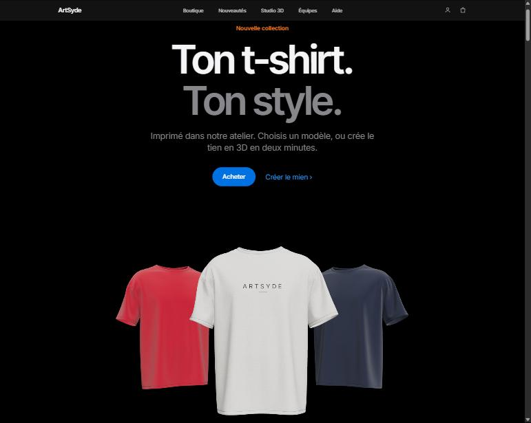
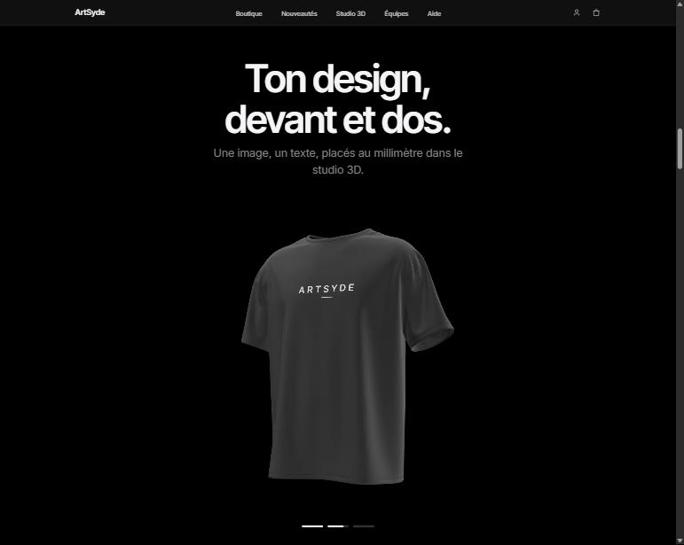
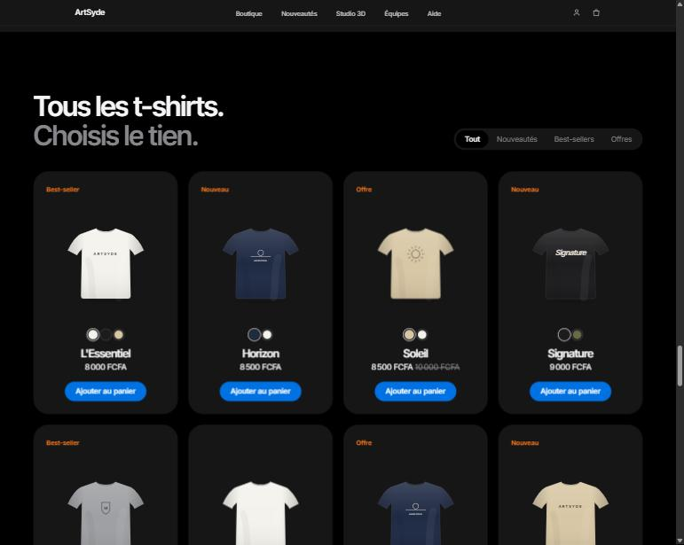
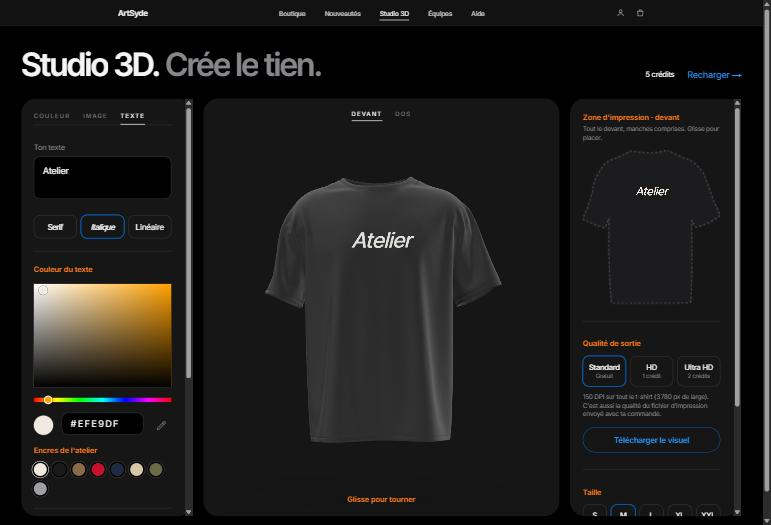
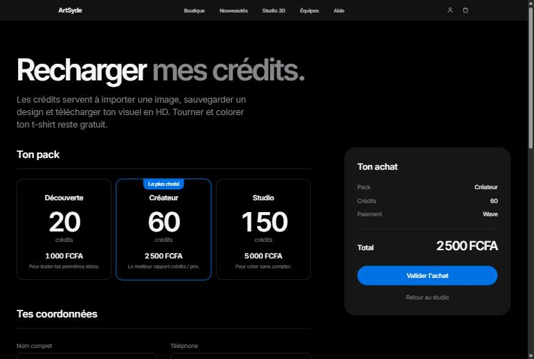

# ArtSyde

Boutique en ligne de t-shirts imprimés dans notre atelier, avec un **studio 3D** pour créer le sien : on choisit la couleur du t-shirt, on place une image ou un texte sur tout le devant et tout le dos, et on le voit en 3D avant de le commander. Prix en francs CFA.



| Le t-shirt en 3D, imprimé devant et dos | La boutique |
| --- | --- |
|  |  |
| **Le studio 3D** | **Les crédits du studio** |
|  |  |

## Ce que fait le site

**Boutique**
- Catalogue lu depuis la base de données, avec les filtres Tout, Nouveautés, Best-sellers et Offres.
- Panier, puis commande enregistrée avec une référence (ex. `AS-2611-0143`) et une page de suivi.
- Le paiement en ligne n'est pas encore branché : la commande est enregistrée « en attente de paiement ».

**Studio 3D** (`/studio`)
- Le vrai modèle d'un t-shirt oversize, qu'on fait tourner à la souris ou au doigt.
- Impression sur tout le devant et tout le dos, manches comprises. La zone 2D, la 3D et le fichier exporté suivent exactement la silhouette du t-shirt.
- Texte (trois styles de police) et image importée, avec la taille affichée en centimètres réels.
- Couleur libre du t-shirt et de l'encre, avec un sélecteur de couleur et une pipette.
- Qualité de sortie Standard, HD ou Ultra HD (150, 225 ou 300 DPI). Elle sert pour le visuel téléchargé et pour le fichier d'impression de la commande.

**Crédits du studio** (`/credits`)
- Trois packs : Découverte, Créateur et Studio.
- L'achat est enregistré non payé. Les crédits sont versés quand l'admin marque le paiement comme reçu.

**Admin** (`/admin`, protégé par mot de passe)
- Vue d'ensemble, commandes, clients, studio, ventes et achats de crédits.
- Produits et stock : création et modification des modèles, et photos envoyées sur Cloudflare R2.

**Animations**
- Un seul système de mouvement pour tout le site : courbes, durées et ressorts partagés.
- Défilement fluide et histoire 3D qui se déroule au défilement.
- Boutons vivants : reflet, pression élastique et onde au clic.
- Un article ajouté vole jusqu'au panier ; un article retiré part dans une poubelle.
- Tout se calme pour les personnes qui ont activé « réduire les animations » sur leur appareil.

## Technologies

| | |
| --- | --- |
| Framework | [Next.js 16](https://nextjs.org) (App Router, Turbopack, Cache Components), React 19, TypeScript |
| Style | Tailwind CSS 4, thème clair et sombre selon l'appareil |
| Animation | [Motion](https://motion.dev), [GSAP](https://gsap.com) + ScrollTrigger, [Lenis](https://lenis.darkroom.engineering) |
| 3D | [three.js](https://threejs.org), [React Three Fiber](https://r3f.docs.pmnd.rs), [drei](https://drei.docs.pmnd.rs) |
| Données | [Prisma 7](https://www.prisma.io) et [Neon](https://neon.tech) (PostgreSQL) |
| Fichiers | [Cloudflare R2](https://developers.cloudflare.com/r2/) pour les photos des produits |

## Démarrer en local

Il faut Node.js 20 ou plus récent, et [pnpm](https://pnpm.io) 10.

1. Installer les dépendances (cela génère aussi le client Prisma) :

   ```bash
   pnpm install
   ```

2. Créer le fichier d'environnement, puis le remplir (voir [Variables d'environnement](#variables-denvironnement)) :

   ```bash
   cp .env.example .env
   ```

3. Créer les tables dans la base Neon :

   ```bash
   pnpm db:deploy
   ```

4. Facultatif : ajouter des données d'exemple pour que l'admin ne soit pas vide. Leurs identifiants commencent tous par `seed_`, et relancer la commande ne touche qu'à ces lignes-là.

   ```bash
   pnpm db:seed
   ```

5. Lancer le site sur [http://localhost:3000](http://localhost:3000) (admin : [http://localhost:3000/admin](http://localhost:3000/admin)) :

   ```bash
   pnpm dev
   ```

## Scripts

| Commande | Rôle |
| --- | --- |
| `pnpm dev` | Serveur de développement |
| `pnpm build` | Build de production (vérifie aussi les types) |
| `pnpm start` | Lance le build de production |
| `pnpm lint` | ESLint |
| `pnpm db:deploy` | Applique les migrations à la base |
| `pnpm db:status` | Montre les migrations appliquées ou en attente |
| `pnpm db:generate` | Régénère le client Prisma après un changement de `prisma/schema.prisma` |
| `pnpm db:seed` | Données d'exemple (`seed_…`) |
| `pnpm db:studio` | Explorer la base dans Prisma Studio |

## Variables d'environnement

Elles sont toutes listées et commentées dans [`.env.example`](.env.example). Le fichier `.env` n'est jamais commité.

| Variable | À quoi elle sert |
| --- | --- |
| `DATABASE_URL` | Connexion Neon « poolée » (l'hôte contient `-pooler`), utilisée par le site |
| `DIRECT_URL` | Connexion Neon directe, utilisée par Prisma pour les migrations |
| `ADMIN_PASSWORD` | Mot de passe de `/admin`. Le changer déconnecte toutes les sessions admin. |
| `R2_ACCOUNT_ID`, `R2_ACCESS_KEY_ID`, `R2_SECRET_ACCESS_KEY`, `R2_BUCKET`, `R2_PUBLIC_URL` | Photos des produits sur Cloudflare R2 (facultatif tant qu'on n'envoie pas de photos) |

### Photos des produits sur Cloudflare R2

1. Créer un bucket, par exemple `artsyde-photos`.
2. Le rendre public, avec un domaine personnalisé ou l'adresse `r2.dev` (Settings → Public access). Cette adresse va dans `R2_PUBLIC_URL`, sans `/` final.
3. Créer un jeton d'API (R2 → Manage API tokens) avec la permission « Object Read & Write », limitée à ce bucket.
4. Autoriser l'envoi depuis le navigateur (Settings → CORS policy), en remplaçant le domaine par le tien :

   ```json
   [
     {
       "AllowedOrigins": ["http://localhost:3000", "https://artsyde.ci"],
       "AllowedMethods": ["PUT"],
       "AllowedHeaders": ["content-type"],
       "MaxAgeSeconds": 3600
     }
   ]
   ```

Les clés ne quittent jamais le serveur : le navigateur envoie chaque photo directement à R2 avec un lien signé, valable uniquement pour un fichier JPG, PNG ou WebP de 8 Mo maximum.

## Organisation du code

```
prisma/
  schema.prisma          modèles : produits, commandes, clients, crédits, designs…
  migrations/            historique des migrations
  seed.ts                données d'exemple (seed_…)
public/models/
  tshirt.glb             le t-shirt 3D (optimisé)
  tshirt-license.txt     sa licence (CC BY 4.0)
src/
  app/                   pages : accueil, studio, panier, commande, crédits, connexion, admin
  components/
    home/                sections de l'accueil
    pages/               vues des pages (studio, panier, commande, crédits…)
    story/               3D : scène du studio, t-shirts du héros, modèle, silhouette
    admin/               écrans de l'admin
    Reveal.tsx           apparitions au défilement (titres, blocs, compteurs…)
    Magnetic.tsx         effets des boutons (attraction, onde au clic)
    SmoothScroll.tsx     défilement fluide (Lenis)
  lib/
    motion.ts            courbes, durées, ressorts : les valeurs d'animation partagées
    catalog.ts           catalogue lu depuis la base
    credits.ts           packs de crédits et moyens de paiement
    studio.ts            qualités de sortie et taille réelle de la zone d'impression
    r2.ts                envoi des photos vers Cloudflare R2
    flyToCart.ts         article qui vole jusqu'au panier
    flyToBin.ts          article retiré qui part dans la poubelle
```

## Le modèle 3D

Le t-shirt est le modèle **« [Oversized t-shirt](https://sketchfab.com/3d-models/oversized-t-shirt-3b6e78d6a1a74370a6e5af6f312d38f7) »** de [kylelhb](https://sketchfab.com/kylelhb), sous licence [CC BY 4.0](http://creativecommons.org/licenses/by/4.0/). L'auteur est crédité dans le pied de page du site, et la licence se trouve dans [`public/models/tshirt-license.txt`](public/models/tshirt-license.txt).

Le fichier d'origine (37 Mo) a été allégé à 746 Ko avec [gltf-transform](https://gltf-transform.dev) : environ 64 000 triangles, géométrie compressée meshopt et textures WebP de 2048 px. Le devant du t-shirt regarde vers +z.

Pour changer de modèle, il faut aussi retracer sa silhouette de face dans `src/components/story/teeOutline.ts`. Elle définit la zone d'impression du studio, et la 3D, l'aperçu 2D et les exports s'appuient dessus.

## Ce qui reste à faire

- **Paiement en ligne** (mobile money ou carte) : les commandes et les achats de crédits sont enregistrés en attente de paiement.
- **Comptes clients** : le solde de crédits du studio est encore simulé (5 crédits au chargement).
- **Photos des produits** : l'envoi est prêt, il attend les clés R2.
